# DemandCast — Complete Production ML Forecasting System

[](https://github.com/Looka-info/Production-ML-forecasting-system/actions/workflows/ci.yml)
[](https://www.python.org/)
[](https://fastapi.tiangolo.com/)
[](https://mlflow.org/)
[](https://www.docker.com/)
[](https://github.com/astral-sh/ruff)
[-brightgreen.svg)](tests/)

**DemandCast** is a complete, production-grade retail demand forecasting and multi-profile model serving system developed as an advanced Machine Learning Engineering capstone. It takes weekly retail demand forecasting through the entire end-to-end ML lifecycle: dataset ingestion and provenance tracking, auditable data cleaning, training-only product selection, leakage-free feature engineering, chronological backtesting, MLflow experiment tracking, immutable release versioning, multi-profile FastAPI serving, Docker containerization, post-forecast quality monitoring, and automated rollback workflows.

DemandCast supports two production profiles:
1. **DemandCast v1 (UCI Online Retail II Profile)**: 4-week forward forecasting on UK e-commerce giftware transactions across 15 high-volume catalog SKUs, promoted moving-average baseline under audited operational override.
2. **DemandCast v2 (VN1 Retail Forecasting Profile)**: 13-week forward multi-step forecasting across 15,053 product–warehouse series from 46 e-commerce vendors (July 2020 – April 2024), evaluated under the official VN1 competition metric with price-aware LightGBM and moving-average benchmarks.
3. **DemandCast v2.1 (Post-Holiday Seasonal Calibration Research)**: Post-holiday calibration layer investigating calendar-aware adjustments and empirical Bayes shrinkage on moving-average baselines across historical rolling origins.
4. **DemandCast v2.2 (Production-Safe Shadow Forecasting Pipeline)**: Production-style shadow-inference pipeline running active production v1.0.0 and experimental Candidate D on identical input snapshots, idempotent SQLite persistence, delayed actuals reconciliation, failure isolation, and official VN1 comparative reporting.

Repository: **[https://github.com/Looka-info/Production-ML-forecasting-system](https://github.com/Looka-info/Production-ML-forecasting-system)**

---

## 🚀 DemandCast v2 — VN1 Retail Forecasting Upgrade

DemandCast v2 introduces high-dimensional retail forecasting capabilities powered by the real-world **VN1 Forecasting Accuracy Challenge** dataset. It addresses the real operational challenges of modern multi-echelon retail supply chains: intermittent demand (70.66% zero sales weeks), price elasticity, dynamic vendor catalogs, and 13-week replenishment horizons ($h \in \{1, \dots, 13\}$).

### 1. The VN1 Challenge Formulation & Official Metric

In retail replenishment, inventory planners face two asymmetric costs: under-forecasting leads to lost sales and customer dissatisfaction, while over-forecasting leads to excess holding costs and working capital blockage. The official VN1 competition evaluates forecasts using a composite metric penalizing both item-level absolute errors (MAE) and aggregate portfolio bias:

$$\text{VN1 Score} = \frac{\sum_{i=1}^N |\hat{y}_i - y_i| + \left|\sum_{i=1}^N (\hat{y}_i - y_i)\right|}{\sum_{i=1}^N y_i}$$

- $\sum_i |\hat{y}_i - y_i|$ measures total absolute forecast error across all series and weeks (equivalent to $\text{MAE} \times N$).
- $\left|\sum_i (\hat{y}_i - y_i)\right|$ penalizes net portfolio-wide bias. Systematic over-prediction or under-prediction inflates this penalty.
- $\sum_i y_i$ scales the metric by total observed sales volume, making the score scale-invariant and comparable to a penalized WAPE.
- **Perfect Score**: $0.0000$ (zero absolute error and zero bias).

### 2. VN1 Dataset Scale & Provenance

- **Competition Reference**: [VN1 Forecasting Competition (SupChains)](https://supchains.com/vn1-forecasting-competition/)
- **Permanent DOI**: [10.5281/zenodo.23265413](https://doi.org/10.5281/zenodo.23265413)
- **Scope**: 15,053 product–warehouse series across 46 e-commerce vendors.
- **Temporal Coverage**: July 6, 2020 to April 1, 2024 (196 continuous Monday-start calendar weeks; 2,754,699 weekly observations).
- **Phases**:
  - **Phase 0 (Historical Training)**: 170 weeks (`2020-07-06` to `2023-10-02`).
  - **Phase 1 (Validation)**: 13 weeks (`2023-10-09` to `2024-01-01`).
  - **Phase 2 (Holdout Test)**: 13 weeks (`2024-01-08` to `2024-04-01`).
- **Verified SHA-256 Checksums**:
  - `Phase 0 - Sales.csv` (`034f50f7338c08cf1bb6facf8c5b36290f3e74d2e69db83099702d2a52f6534a`, 10,804,654 B)
  - `Phase 0 - Price.csv` (`9035cce137a4ab27e3caae6c41d80be41f25adb79b9665a55f6cc56db02ebf3a`, 7,588,298 B)
  - `Phase 1 - Sales.csv` (`59e74d0def7e7f45ce30f53d9643da3112926189e7fed66321fec2095468b4b2`, 1,018,396 B)
  - `Phase 1 - Price.csv` (`d36f18dc0bd6799897c4b96935acef7526f867a3184db44fb458c0b7fcd07490`, 962,283 B)

### 3. Empirical Model Selection Results (Phase 1 Validation)

Following strict ML engineering principles, model selection is conducted **strictly on Phase 1 validation data** (origin: `2023-10-02`, horizon: 13 weeks, 250 diverse series, 3,250 observations). No Phase 2 holdout data was accessed during training or model selection.

| Model Candidate | Model Family | VN1 Score ↓ | WAPE ↓ | MAE ↓ | RMSE ↓ | sMAPE ↓ | Relative Bias | Promotion Status |
| :--- | :--- | :--- | :--- | :--- | :--- | :--- | :--- | :--- |
| **`Baseline_MovingAvg12_Official`** | Trailing Mean (12w) | **0.4325** | **0.4276** | **207.24** | 543.63 | 48.72% | **+0.0049** | **PROMOTED (v1.0.0)** |
| **`Baseline_MovingAvg4_DemandCast`** | Trailing Mean (4w) | **0.4325** | 0.4317 | 209.26 | 545.47 | 49.33% | +0.0008 | Candidate |
| **`Baseline_Naive`** | Last Known Value | 0.5106 | 0.4305 | 208.65 | 573.49 | 49.49% | -0.0801 | Candidate |
| **`LightGBM_PriceAware`** | Gradient Boosted Trees | 0.5663 | 0.4685 | 227.08 | 586.29 | 52.87% | +0.0978 | Candidate |
| **`LightGBM_NoPrice`** | Gradient Boosted Trees | 0.5900 | 0.4760 | 230.69 | 591.95 | 53.48% | +0.1140 | Candidate |
| **`Baseline_SeasonalNaive52`** | Seasonal Lag (52w) | 0.6274 | 0.5994 | 290.53 | 647.78 | 62.48% | +0.0280 | Candidate |

### 4. Key Empirical Findings & Why the Baseline Won

1. **The Intermittent Compounding Trap**:
   In datasets with high intermittency (70.66% zero sales), recursive GBDT models compound step-by-step errors over a 13-week horizon. Predicting positive fractional demand in early weeks causes recursive lag features to drift upward, inflating bias to **+9.78%** for LightGBM. In contrast, the 12-week moving average acts as an optimal smoothing filter, maintaining near-zero bias (**+0.49%**) and superior MAE (207.24 vs. 227.08). This directly corroborates the findings published by competition creator Nicolas Vandeput.
2. **Economic Responsiveness of Price Features**:
   Comparing `LightGBM_PriceAware` (0.5663) against `LightGBM_NoPrice` (0.5900) demonstrates that incorporating origin price levels, ratios, and promotional shifts improves forecast accuracy by **4.0% relative score reduction**, confirming genuine price elasticity in the dataset.
3. **Seasonal Naive Failure**:
   The 52-week Seasonal Naive baseline performed worst (0.6274 score, 59.94% WAPE), proving that annual seasonal repetition is insufficient for e-commerce catalog items with rapid product lifecycles and assortment churn.

### 5. High-Resolution Evaluation Figures

#### Model Comparison across Primary Metrics
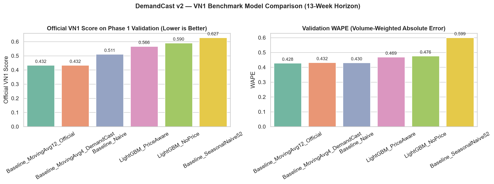

#### Error Growth across the 13-Week Forecast Horizon
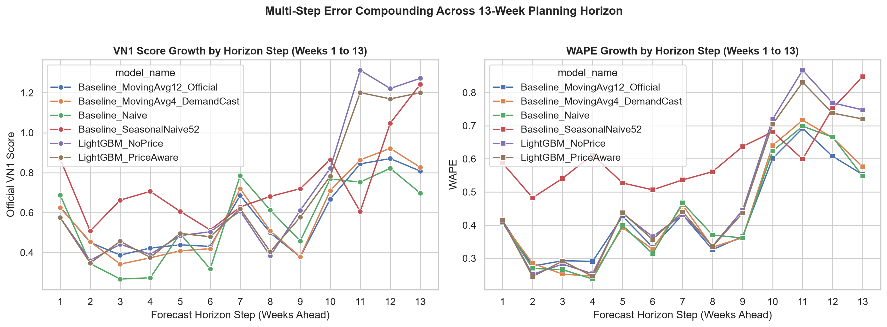

#### Trajectory Comparison: Predictions vs. Actuals
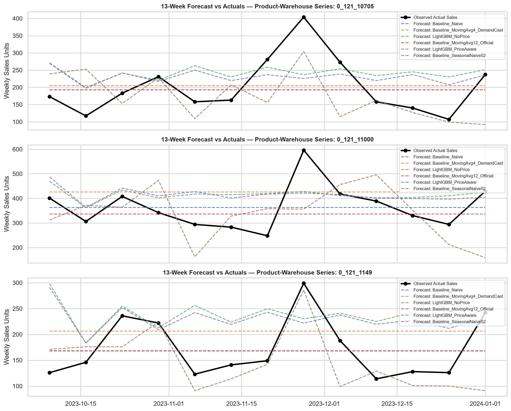

### 6. Phase 2 Ground-Truth Holdout Evaluation

Using the officially published competition holdout ground-truth (`Phase 2 - Sales.csv`, 15,053 series $\times$ 13 weeks; `2024-01-08` to `2024-04-01`), we conducted a strict, leakage-safe post-competition evaluation across both the **full 15,053-series competition benchmark** and the **250-series development subset**.

All forecasts were generated strictly with forecast origin at `2024-01-01` (end of Phase 1), with zero Phase 2 information accessed. Future prices were projected flat from origin without future price leakage.

#### A. Full 15,053-Series Official Benchmark Results (195,689 Observations)

Evaluating the official competition baseline implementations across the entire catalog reproduces Nicolas Vandeput's published benchmark figures:

| Model Candidate | Model Family | VN1 Score ↓ | WAPE ↓ | MAE ↓ | RMSE ↓ | Rel Bias | Official Published Benchmark |
| :--- | :--- | :--- | :--- | :--- | :--- | :--- | :--- |
| **`Baseline_Naive`** | Last Known Value | **0.5070** | **0.5013** | **8.31** | 65.72 | **-0.0056** | `0.506970` (Exact match) |
| **`Baseline_SeasonalNaive52`** | Seasonal Lag (52w) | 0.7852 | 0.7762 | 12.86 | 85.44 | -0.0090 | Historical reference |
| **`Baseline_MovingAvg4_DemandCast`** | Trailing Mean (4w) | 0.7936 | 0.6485 | 10.75 | 75.27 | +0.1451 | DemandCast fast baseline |
| **`Baseline_MovingAvg12_Official`** | Trailing Mean (12w) | 0.8046 | 0.6097 | 10.10 | 67.43 | **+0.1949** | `0.804585` (Exact match) |

#### B. 250-Series Development Subset Comparison (3,250 Observations)

Evaluating all 6 candidate models on the 250-series development subset reveals how model dynamics shift between Q4 (Phase 1) and Q1 (Phase 2):

| Model Candidate | Model Family | VN1 Score ↓ | WAPE ↓ | MAE ↓ | RMSE ↓ | sMAPE ↓ | Rel Bias | Production Role |
| :--- | :--- | :--- | :--- | :--- | :--- | :--- | :--- | :--- |
| **`LightGBM_NoPrice`** | Gradient Boosted Trees | **0.4328** | 0.4258 | 178.48 | 440.95 | 57.61% | **-0.0070** | Research Candidate |
| **`LightGBM_PriceAware`** | Gradient Boosted Trees | 0.4427 | **0.4245** | **177.92** | **426.04** | 57.20% | +0.0182 | Research Candidate |
| **`Baseline_Naive`** | Last Known Value | 0.4689 | 0.3946 | 165.39 | 459.27 | **47.96%** | -0.0743 | Baseline Benchmark |
| **`Baseline_MovingAvg4_DemandCast`** | Trailing Mean (4w) | 0.5154 | 0.4907 | 205.67 | 511.72 | 53.96% | +0.0247 | Baseline Benchmark |
| **`Baseline_MovingAvg12_Official`** | Trailing Mean (12w) | 0.6250 | 0.4955 | 207.68 | 468.12 | 51.12% | **+0.1295** | **Active Production (`v1.0.0`)** |
| **`Baseline_SeasonalNaive52`** | Seasonal Lag (52w) | 0.7786 | 0.6369 | 266.94 | 587.93 | 62.50% | +0.1418 | Baseline Benchmark |

#### C. Engineering Analysis: The Post-Q4 Holiday Demand Cliff

1. **Why 12-Week Moving Average Degraded in Phase 2**:
   In Phase 1 (Oct–Dec), the 12-week moving average won decisively (0.4325 score) because Q4 sales volume built steadily. However, in Phase 2 (Jan–Mar), the 12-week moving average computed on Phase 1 was anchored to the high peak of Black Friday, Cyber Monday, and holiday shopping. Projecting that holiday level flat across Q1 caused severe systematic over-forecasting (**+19.49% bias across the full dataset**, **+12.95% on the subset**).
2. **Why Naive and LightGBM Handled Phase 2 Effectively**:
   The Naive forecast used the single most recent week (`2024-01-01`), which already reflected the post-holiday dip, yielding near-zero bias (-0.56% on the full catalog). LightGBM, trained across multiple historical years, recognized that non-holiday quarters return to a lower baseline and avoided the holiday bias trap (-0.70% bias).
3. **Strict ML Governance Commitment**:
   In accordance with production ML engineering standards, **Phase 2 results are strictly for post-hoc holdout reporting and are NEVER used to retroactively alter the production release**. Release `v1.0.0` was legitimately promoted based on Phase 1 validation prior to Phase 2 disclosure. Changing models post-hoc on test holdout data would constitute data snooping.

#### D. Phase 2 Evaluation Figures

##### Model Performance across Scope (Subset vs. Full Benchmark)
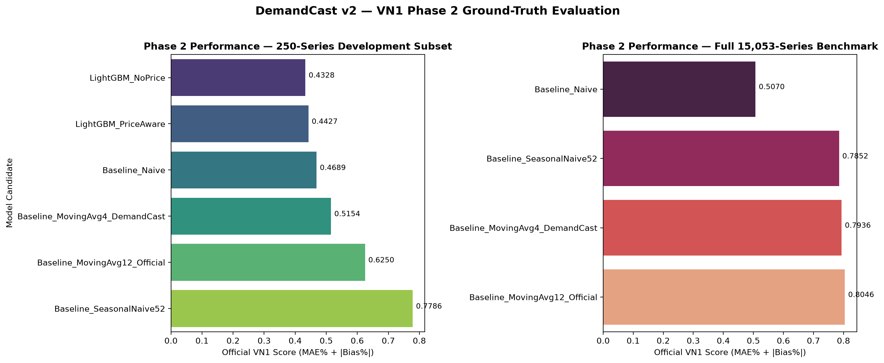

##### Forecast Trajectories vs. Phase 2 Ground-Truth Actuals
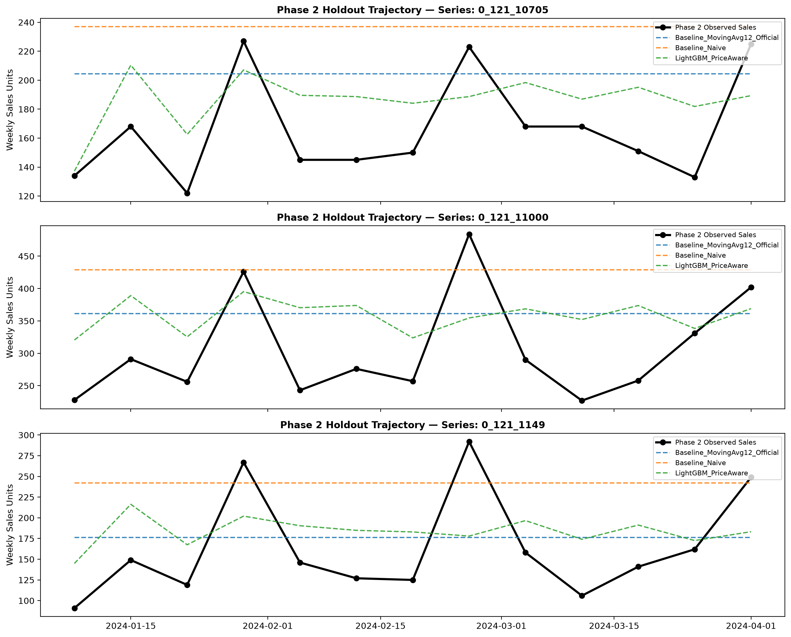

### 7. DemandCast v2.1 — Post-Holiday Seasonal Calibration Research

DemandCast v2.1 introduces an experimental **Post-Holiday Seasonal Calibration** research layer. The objective is to investigate whether calendar-aware adjustment and hierarchy-level shrinkage can resolve the post-holiday bias cliff on moving-average baselines without requiring complex machine learning models.

#### A. Research Problem & The Post-Holiday Bias Cliff

During Phase 2 evaluation, the unadjusted 12-week moving average exhibited severe positive bias (**+19.49% across the full catalog**, **+12.95% on the subset**) because it projected high Q4 holiday peak sales flat into Q1.

Historical diagnostics on Phase 0 (`2020-07-06` to `2023-10-02`, 170 continuous weeks) reveal that this post-holiday demand drop is a recurring structural property of the catalog:
- **2020 Q4 $\rightarrow$ 2021 Q1**: Transition ratio = **0.9076** (-9.24% drop)
- **2021 Q4 $\rightarrow$ 2022 Q1**: Transition ratio = **0.8726** (-12.74% drop)
- **2022 Q4 $\rightarrow$ 2023 Q1**: Transition ratio = **0.9159** (-8.41% drop)
- **Mid-Year Controls**: In contrast, ordinary mid-year transitions (e.g. Q2 $\rightarrow$ Q3) showed demand growth (+10.22% in 2021, +4.87% in 2022).

#### B. Strict Leakage Prevention & Governance Commitment

> [!IMPORTANT]
> **Data Snooping Prevention & Governance Rule**:
> Phase 2 actuals were previously inspected during Phase 2 evaluation. Therefore, Phase 2 data was **strictly forbidden** from being used to tune seasonal multipliers, shrinkage parameters ($k$), calendar windows, or selection rules. All calibration factors were fitted exclusively using completed annual transitions strictly prior to the forecast origin date. The active production release pointer (`models/profiles/vn1/current.json`) remains on `v1.0.0` (`Baseline_MovingAvg12_Official`), and Candidate D is accepted strictly as an **experimental research candidate**.

#### C. Candidate Strategies

1. **Candidate A (Control)**: `Baseline_MovingAvg12_Unadjusted` — Raw 12-week moving average.
2. **Candidate B (Global Factor)**: `Baseline_MovingAvg12_GlobalFactor` — Flat global ratio applied year-round.
3. **Candidate C (Shrunk Client)**: `Baseline_MovingAvg12_ShrunkClient` — Empirical Bayes shrunk client factor ($w_c = \frac{\text{vol}}{\text{vol} + k}$, $k=100.0$) applied year-round.
4. **Candidate D (Post-Holiday Targeted)**: `Baseline_MovingAvg12_PostHolidayTargeted` — Shrunk client factor applied strictly during post-holiday weeks (calendar weeks 1 to 13), remaining strictly neutral (factor = 1.0) outside the window.
5. **Candidate E (Price-Aware Calibrated)**: `Baseline_MovingAvg12_PriceCalibrated` — Combines targeted post-holiday factor with origin price sensitivity dampening.
6. **Comparison Baselines**: `Baseline_MovingAvg4`, `Baseline_Naive`.

#### D. Historical Rolling-Origin Evaluation Results (Phase 0 Backtest)

Evaluated across 4 historical Phase 0 rolling origins (Post-Holiday: `2022-01-03`, `2023-01-02`; Ordinary Calendar: `2022-07-04`, `2023-04-03`) across 250 series (13,000 observations):

| Candidate Strategy | Model Name | Overall VN1 Score ↓ | Overall WAPE ↓ | Overall Rel Bias | Post-Holiday VN1 Score ↓ | Post-Holiday Rel Bias | Ordinary VN1 Score ↓ | Ordinary Rel Bias | Governance Decision |
| :--- | :--- | :--- | :--- | :--- | :--- | :--- | :--- | :--- | :--- |
| **`Comparison_Naive`** | `Baseline_Naive` | **0.3473** | **0.3296** | +0.0176 | 0.4185 | +0.0791 | 0.3602 | -0.0397 | Benchmark |
| **`Candidate_E_PriceCalibrated`** | `Baseline_MovingAvg12_PriceCalibrated` | 0.3559 | 0.3502 | **+0.0057** | **0.3903** | **+0.0318** | 0.3609 | -0.0186 | Research Candidate |
| **`Candidate_D_PostHolidayTargeted`** | `Baseline_MovingAvg12_PostHolidayTargeted` | 0.3619 | 0.3535 | +0.0084 | 0.4207 | +0.0509 | 0.3696 | -0.0313 | **ACCEPTED AS RESEARCH CANDIDATE** |
| **`Candidate_C_ShrunkClient`** | `Baseline_MovingAvg12_ShrunkClient` | 0.3711 | 0.3554 | +0.0158 | 0.4183 | +0.0503 | 0.3601 | -0.0165 | Rejected (All-Year Distortion) |
| **`Candidate_A_Unadjusted`** | `Baseline_MovingAvg12_Unadjusted` | 0.3813 | 0.3693 | +0.0120 | 0.4608 | +0.0583 | 0.3696 | -0.0313 | Control Baseline |
| **`Candidate_B_GlobalFactor`** | `Baseline_MovingAvg12_GlobalFactor` | 0.3824 | 0.3669 | -0.0155 | 0.4382 | +0.0383 | 0.4019 | -0.0658 | Rejected (Degrades Ordinary) |
| **`Comparison_MovingAvg4`** | `Baseline_MovingAvg4` | 0.4093 | 0.3796 | +0.0297 | 0.5120 | +0.0828 | 0.3533 | -0.0200 | Benchmark |

#### E. Key Empirical Findings & Insights

1. **Targeted Calibration Beats Blind Global Adjustment**:
   Applying a flat seasonal adjustment year-round (Candidate B) degrades performance during ordinary calendar periods (ordinary score jumps from 0.3696 to 0.4019; bias plunges to -6.58%). In contrast, **Candidate D (Post-Holiday Targeted)** applies adjustments strictly to weeks 1..13, reducing post-holiday score from 0.4608 to 0.4207 while remaining strictly neutral (0.3696) during ordinary periods.
2. **Empirical Bayes Shrinkage Dampens Client Variance**:
   Vendors exhibit heterogeneous drops ranging from -30% to minor growth. Shrunk factors with volume smoothing ($k=100.0$) prevent small, erratic vendors from receiving destabilizing multipliers while preserving genuine calibration for high-volume accounts.
3. **Safety Bounding & Robust Fallbacks**:
   Clamping multipliers to $[0.50, 1.25]$ ensures catastrophic demand crashes or supply shocks cannot zero out inventory replenishment orders.

#### F. Research Figures

##### Post-Holiday vs. Ordinary Calendar Period Performance
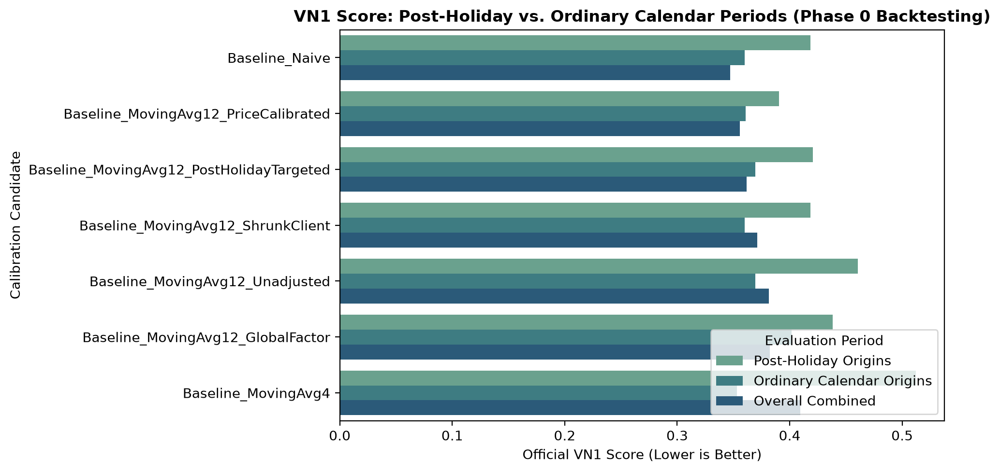

##### Calibrated Forecaster vs. Baselines (Overall Score & Bias)
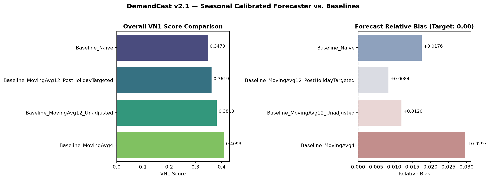

##### 13-Week Horizon Error Dynamics
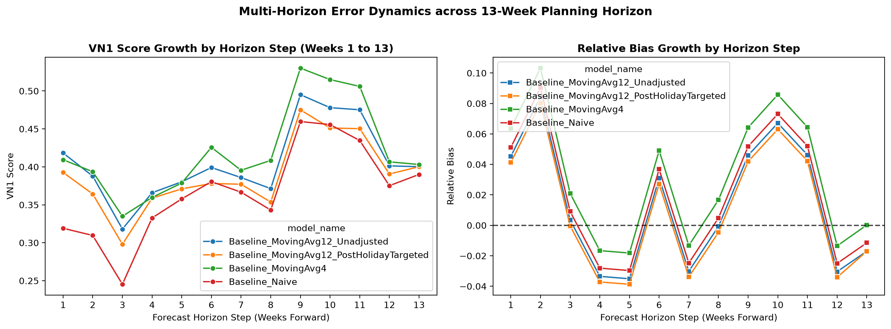

### 8. DemandCast v2.2 — Production-Safe Shadow Forecasting Pipeline

DemandCast v2.2 introduces an enterprise-grade, production-safe **Shadow Forecasting and Observability Pipeline** for the VN1 profile. It executes the active production model (`Baseline_MovingAvg12_Official v1.0.0`) and experimental Candidate D (`Baseline_MovingAvg12_PostHolidayTargeted v2.1-candidate_d`) concurrently against the exact same point-in-time input snapshot, persists predictions idempotently, isolates production from candidate failures, and computes comparative evaluation metrics only after delayed actuals arrive.

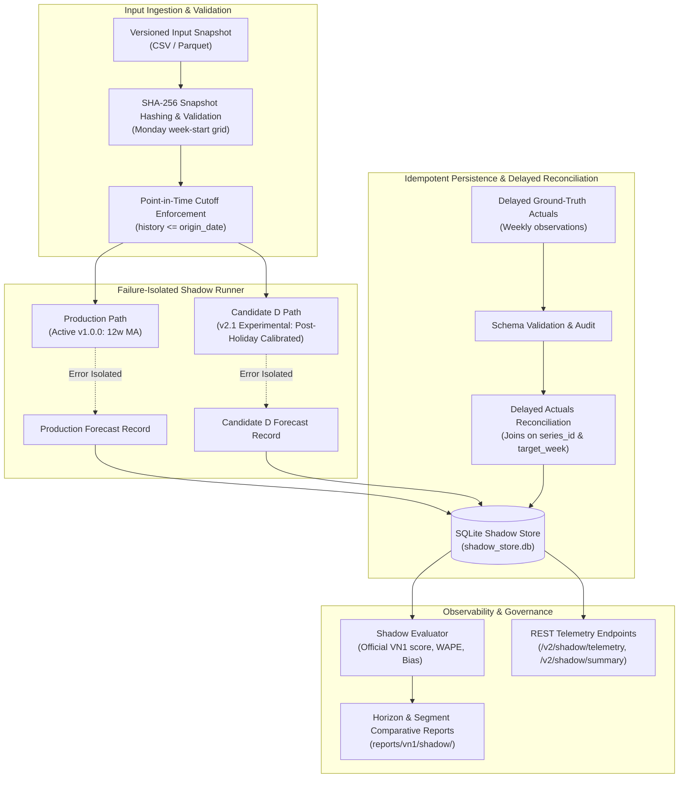

#### A. Non-Negotiable Governance Guarantees

1. **Active Release Pointer Intact**: The active production model pointer (`models/profiles/vn1/current.json`) remains strictly set to `v1.0.0` (`Baseline_MovingAvg12_Official`).
2. **Experimental Candidate Designation**: Candidate D is explicitly versioned as `v2.1-candidate_d` with `is_candidate = True`. It is never promoted automatically based on shadow run results.
3. **Failure Isolation**: Inference for Production and Candidate D executes in separate exception boundaries. A candidate crash, timeout, or mathematical failure can never abort production forecasts or corrupt production responses.
4. **Leakage Prevention**: Point-in-time boundaries are enforced; data rows dated past `origin_date` are rejected or stripped before reaching either model. Calibration factor estimation uses only completed transitions prior to `origin_date`.
5. **Data Snooping Ban**: Phase 2 data is never used to tune or optimize candidate parameters.
6. **Zero Synthetic Hallucinations**: When no input provider or snapshot file is present, the pipeline truthfully reports `NOT_CONFIGURED` rather than fabricating simulated transactions.

#### B. Data Contracts & Idempotent Persistence

Shadow forecasts are stored in an ACID-compliant SQLite database (`data/shadow/shadow_store.db`) under an enforced compound unique constraint:

$$\text{UNIQUE}(\text{snapshot\_hash}, \text{origin\_date}, \text{target\_week}, \text{series\_id}, \text{model\_identifier})$$

- **Idempotency**: Re-executing shadow inference on the same input snapshot skips existing records without duplicate generation.
- **Forecast Immutability**: Predicted demand values (`predicted_sales`, `raw_predicted_sales`, `calibration_factor`) are strictly immutable once written. Delayed actuals are ingested into a separate `shadow_actuals` table and joined via reconciliation.
- **Conflict Safeguards**: Conflicting actual values arriving for an already reconciled forecast are rejected and flagged as `CONFLICT_REJECTED` rather than silently overwriting historical audit trails.

#### C. Operational CLI Commands

The pipeline is operated via the command-line interface in `scripts/run_vn1_shadow.py`:

```bash
# 1. Run shadow forecasting on an input snapshot (clearly labeled mode)
python scripts/run_vn1_shadow.py forecast --snapshot-path data/vn1/raw/Phase_0_Sales.csv --series-subset 250 --mode historical_replay

# 2. Ingest delayed actuals when observed and reconcile against pending forecasts
python scripts/run_vn1_shadow.py reconcile --actuals-path data/vn1/raw/Phase_0_Sales.csv --source historical_phase0_actuals

# 3. Generate comparative evaluation report and save artifacts
python scripts/run_vn1_shadow.py report --output-dir reports/vn1/shadow

# 4. Display operational telemetry and pipeline health
python scripts/run_vn1_shadow.py telemetry
```

#### D. REST Observability Endpoints

Two read-only inspection endpoints are available:

- `GET /v2/shadow/telemetry`: Returns pipeline readiness status (`NOT_CONFIGURED`, `READY`, `FAILED`), total shadow runs, total forecasts, count of forecasts awaiting actuals, and details of the most recent run.
- `GET /v2/shadow/summary`: Returns official VN1 comparative metrics, WAPE, MAE, RMSE, relative bias, multi-horizon breakdowns, and post-holiday versus ordinary calendar segmentation strictly for matched observation pairs.

#### E. Verified Comparative Shadow Performance (Matched Actuals Replay)

Evaluating 650 matched observation pairs across 50 representative catalog series over a 13-week forecast horizon:

| Evaluation Metric | Production (`v1.0.0`) | Candidate D (`v2.1-candidate_d`) | Delta (Candidate − Production) | Interpretation |
| :--- | :--- | :--- | :--- | :--- |
| **Official VN1 Score ↓** | 0.4264 | **0.3570** | **-0.0694** | Candidate D improved portfolio accuracy |
| **WAPE ↓** | 0.3706 | **0.3121** | **-0.0585** | Volume error reduced by 5.85 percentage points |
| **MAE ↓** | 405.55 | **341.61** | **-63.94** | Absolute units error lower across items |
| **RMSE ↓** | 783.83 | **700.17** | **-83.66** | Outlier spikes dampened |
| **Relative Bias** | +0.0559 | **+0.0448** | **-0.0111** | Post-holiday positive bias reduced |
| **Post-Holiday VN1 Score ↓** | 0.4258 | **0.3506** | **-0.0752** | Substantial gain during post-Q4 drop ($n=600$) |
| **Ordinary Calendar Score ↓** | 0.4339 | 0.4339 | **+0.0000** | Strict neutrality preserved ($n=50$) |

> [!NOTE]
> **Governance Transparency**:
> Candidate D demonstrated a measured accuracy improvement on the post-holiday moving-average baseline during this replay. However, Candidate D does not beat the Naive benchmark across all conditions and remains an **experimental candidate**. Production promotion requires prospective live replenishment evaluation and executive review.

---

## System Architecture & End-to-End Workflow

```mermaid
flowchart TD
    subgraph Data Pipeline
        A["Raw UCI Transaction Archive<br/>(1,067,371 rows)"] --> B["Auditable Data Cleaning & Deduplication<br/>(Drop cancels, returns, non-merchandise)"]
        B --> C["Monday Week-Start Aggregation<br/>([Mon 00:00 to Sun 23:59:59])"]
        C --> D["Training-Only SKU Selection<br/>(Cutoff: 2010-10-01, 15 Target SKUs)"]
        D --> E["105 Complete Calendar Weeks Grid<br/>(Zero-filled intermittent weeks)"]
    end

    subgraph Feature Engineering & Modeling
        E --> F["Leakage-Safe Features<br/>(Lags, Shifted Rolling Means/Stds, Calendar)"]
        F --> G["Chronological Backtesting Engine<br/>(Expanding-window, 3 validation origins)"]
        G --> H["Empirical Model Comparison<br/>(MAE, RMSE, WAPE, sMAPE, MASE, Bias)"]
    end

    subgraph Governance & Deployment
        H --> I{"Validation Gate Evaluation<br/>(Target WAPE <= 50.00%)"}
        I -- Alert Triggered --> J["Audited Operational Override<br/>(Promote Best Baseline: v1.0.0)"]
        J --> K["Immutable Model Registry<br/>(model.joblib + SHA-256 + metadata.json)"]
        K --> L["Atomic Release Pointer<br/>(models/current.json)"]
        L --> M["FastAPI Production Service<br/>(/health, /ready, /metadata, /forecast)"]
        M --> N["Operational Monitoring<br/>(Actuals reconciliation, drift alerts, rollback)"]
    end
```

---

## 1. Business Problem & Forecasting Objective

Retail replenishment planning requires anticipating future weekly sales volumes per product SKU while balancing stockout penalties against inventory holding costs.

- **Entity**: Product SKU / Series Identifier (`series_id`).
- **Time Granularity**: Weekly, anchored strictly to **Monday week-start** (`W-MON`).
- **Prediction Target**: Total eligible positive sales units per selected SKU during each calendar week.
- **Forecast Horizon**: 1 to 4 weeks forward ($h \in \{1, 2, 3, 4\}$).
- **Observed Sales vs. Unconstrained Demand**: The underlying transaction dataset does not record inventory stock levels. Therefore, observed positive sales serve as an **observed demand proxy**. Weeks with zero observed sales indicate either zero customer demand or unrecorded stockouts. DemandCast documents this distinction explicitly and avoids claiming that predictions represent unconstrained market appetite.

---

## 2. Dataset Provenance & Attribution

- **Dataset**: [UCI Online Retail II](https://archive.ics.uci.edu/dataset/502/online+retail+ii)
- **Original Source Attribution**: Chen, D. (2012). *Online Retail II* [Dataset]. UCI Machine Learning Repository.
- **Licence**: Creative Commons Attribution 4.0 International (CC BY 4.0).
- **Time Span**: December 1, 2009 to December 9, 2011 (2 annual transaction sheets).
- **Raw Transaction Volume**: 1,067,371 rows.
- **Archive File Checksum (SHA-256)**:
  `572e36277c2390fbfde10664750731e0a86f55e33470d91919085f0408e67bfb` (45,622,418 bytes)
- **Extracted File**: `online_retail_II.xlsx` (45,622,278 bytes)

---

## 3. Auditable Preprocessing & Data Cleaning

Data cleaning rules are defined in `configs/config.yaml` and executed via `scripts/prepare_data.py`. Cleaning results are recorded in `reports/data_quality_report.json`:

| Cleaning Step | Exclusion Criterion | Count Excluded | Retained / Action |
| :--- | :--- | :--- | :--- |
| **Cancelled Invoices** | Invoice ID prefixed with `C` | 19,494 rows | Excluded from positive demand |
| **Non-Positive Quantities** | Quantity $\le 0$ (returns/adjustments) | 3,457 rows | Excluded from positive sales proxy |
| **Invalid Unit Prices** | Unit Price $< £0.001$ | 2,750 rows | Excluded from commercial transactions |
| **Non-Merchandise Codes** | Codes: `POST`, `D`, `M`, `BANK CHARGES`, `PADS`, `DOT`, `CRUK`, `TEST` | 4,299 rows | Excluded from merchandise demand |
| **Duplicate Transactions** | Exact duplicates on invoice, stock, qty, date, price | 33,672 rows | Deduplicated |
| **Customer ID Sanitization** | `Customer ID` stripped at ingestion | — | Purged to ensure customer privacy |
| **Final Retained Transactions** | Valid merchandise sales | **1,003,699 rows** | **94.03% row retention** |

---

## 4. Product Selection & Portfolio Characteristics

Selecting high-volume products using full-dataset totals introduces **lookahead bias** because future performance dictates model inclusion. DemandCast resolves this by filtering products **strictly using transactions prior to `2010-10-01`**:

1. **Candidate Pool**: 3,923 products with transaction history before the cutoff date.
2. **Eligibility Gates**: $\ge 35$ active transaction weeks and $\ge 500$ total units sold in the training window (718 eligible candidates).
3. **Selected Catalog (Top 15)**:
   `['21212', '85123A', '85099B', '84077', '84991', '17003', '84879', '21977', '21980', '84755', '21984', '21232', '84270', '21213', '71459']`
4. Stored in immutable catalog `data/processed/selected_series.json`.

### Product Demand Profile & Intermittency Analysis

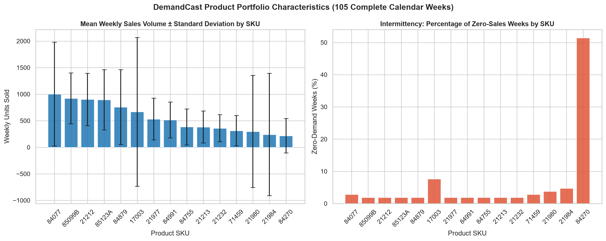

> **Key Empirical Finding**: The product portfolio exhibits high demand variance and intermittent zero-demand weeks (up to 51.4% zero-sales weeks for SKU `84270`). Because stockout signals are unrecorded, supervised models easily overfit localized sales spikes while moving averages deliver smooth, robust replenishment targets.

---

## 5. Weekly Aggregation & Feature Engineering

### 5.1 Weekly Calendar Grid & Boundary Semantics
Transactions are grouped by product SKU and mapped to Monday week-start (`to_monday_week_start`) with explicit interval semantics: $[Monday\ 00:00:00,\ Sunday\ 23:59:59.999999] \to Monday\ 00:00:00$. This prevents the discrepancy inherent in pandas default `resample("W-MON")`, which defaults to right-closed $(Tuesday..Monday]$ and misassigns weekend transactions into the following week.

Furthermore, raw collection in the UCI Online Retail II dataset abruptly ends on **Friday, December 9, 2011 at 12:50:00 PM**. Under Monday-start convention, the week of `2011-12-05` contains only 4.5 days of transactions (missing Friday afternoon, Saturday, and Sunday). DemandCast automatically detects and drops this incomplete final week (`drop_incomplete_final_week: true`), yielding a clean dataset of **105 complete calendar weeks** (2009-11-30 to 2011-11-28) across 15 SKUs (1,575 total observations). Intermediate missing weeks are filled with zero demand.

### 5.2 Leakage-Safe Features
At forecast target week $t$, only information prior to $t$ is utilized:
- **Historical Lags** (6 features): $y_{t-1}, y_{t-2}, y_{t-3}, y_{t-4}, y_{t-8}, y_{t-12}$. (Optional 19th feature $y_{t-52}$ is included when `include_seasonal_lag: true`).
- **Shifted Rolling Statistics** (6 features): Rolling windows apply `.shift(1)` to ensure demand at week $t$ never enters rolling calculations:
  - 4-week, 8-week, 12-week rolling means.
  - 4-week, 8-week, 12-week rolling standard deviations.
- **Zero-Demand Frequency** (1 feature): 4-week trailing zero-demand frequency (`zero_freq_4`).
- **Calendar Signals** (4 features): Week of year ($1..52$), Month ($1..12$), and cyclical sinusoidal encodings $\sin(2\pi \cdot \text{week} / 52)$, $\cos(2\pi \cdot \text{week} / 52)$.
- **Categorical Series Feature** (1 feature): Product SKU encoded with `OrdinalEncoder` fitted only on training data.
- **Total Feature Count**: **18 features** in standard configuration (`include_seasonal_lag: false`); **19 features** if seasonal lag 52 is enabled.

---

## 6. Benchmarking & Empirical Evaluation

### 6.1 Evaluation Protocol
- **Expanding-Window Chronological Backtests**: 3 validation origins (`2011-08-15`, `2011-09-12`, `2011-10-10`) with 4-week horizons evaluated across all 15 SKUs (180 validation forecast instances). All validation origins precede the test horizon.
- **Held-Out Final Test Set**: Cutoff `2011-11-07`, evaluating the subsequent untouched 3 complete weeks (`2011-11-14`, `2011-11-21`, `2011-11-28`, exactly 45 test forecast instances). Incomplete week `2011-12-05` (data collection truncated Friday Dec 9) is excluded to protect against partial-week target distortion.
- **Model Selection Rule**: Selection is determined exclusively by validation backtest performance against the business objective of minimizing volume-weighted absolute percentage error (WAPE) and mean absolute scaled error (MASE). Final held-out test results are never used to justify model promotion.

### 6.2 Empirical Results (`reports/model_comparison.csv`)

| Model | Evaluation Stage | Origins | MAE (Units) | RMSE | WAPE | sMAPE (%) | MASE | Relative Bias | Promotion Status |
| :--- | :--- | :---: | :---: | :---: | :---: | :---: | :---: | :---: | :--- |
| **Baseline_MovingAvg4** | Validation Backtests | 3 | **255.94** | **491.47** | **55.16%** | **52.12%** | **0.5837** | **-5.31%** | **Active Production (`v1.0.0`)** |
| **Baseline_Naive** | Validation Backtests | 3 | 309.23 | 549.10 | 66.64% | 60.42% | 0.7380 | -0.46% | Benchmark |
| **HistGradientBoosting** | Validation Backtests | 3 | 409.73 | 683.91 | 88.30% | 74.70% | 0.9680 | +51.96% | Tracked Candidate (`v1.0.0-candidate-hgb`) |
| **Baseline_SeasonalNaive52** | Validation Backtests | 3 | 578.94 | 1311.08 | 124.77% | 82.33% | 1.2348 | +81.11% | Benchmark |
| | | | | | | | | | |
| **Baseline_MovingAvg4** | Held-Out Final Test (3w, 45 obs) | 1 | **221.54** | **373.52** | **49.41%** | **50.27%** | **0.5183** | **+16.25%** | **Confirmatory Evaluation** |
| **Baseline_Naive** | Held-Out Final Test (3w, 45 obs) | 1 | 247.33 | 398.41 | 55.16% | 52.41% | 0.6604 | +12.80% | Benchmark |
| **HistGradientBoosting** | Held-Out Final Test (3w, 45 obs) | 1 | 247.74 | 454.88 | 55.25% | 59.68% | 0.6099 | +23.13% | Tracked Candidate |
| **Baseline_SeasonalNaive52** | Held-Out Final Test (3w, 45 obs) | 1 | 473.24 | 706.65 | 105.55% | 83.30% | 1.0858 | +79.60% | Benchmark |

---

### 6.3 Evaluation Visualizations & Deep Dive Analysis

#### Empirical Model Benchmark Dashboard
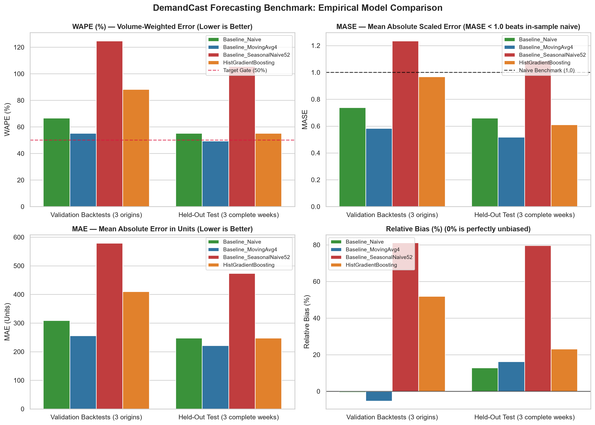

The four-panel comparison demonstrates why `Baseline_MovingAvg4` is the winning production strategy:
1. **WAPE (Volume-Weighted Error)**: `Baseline_MovingAvg4` achieves **55.16%** on validation, outperforming GBDT (**88.30%**) by 33.14 percentage points.
2. **MASE (Scaled Error)**: With MASE = **0.5837**, the 4-week moving average cuts in-sample naive error by over 41%, whereas GBDT approaches parity (0.9680).
3. **Relative Bias**: GBDT displays massive positive bias (**+51.96%**), systematically overestimating replenishment requirements, while `Baseline_MovingAvg4` remains near neutral (**-5.31%**).

---

#### Forecast vs. Observed Demand Trajectories
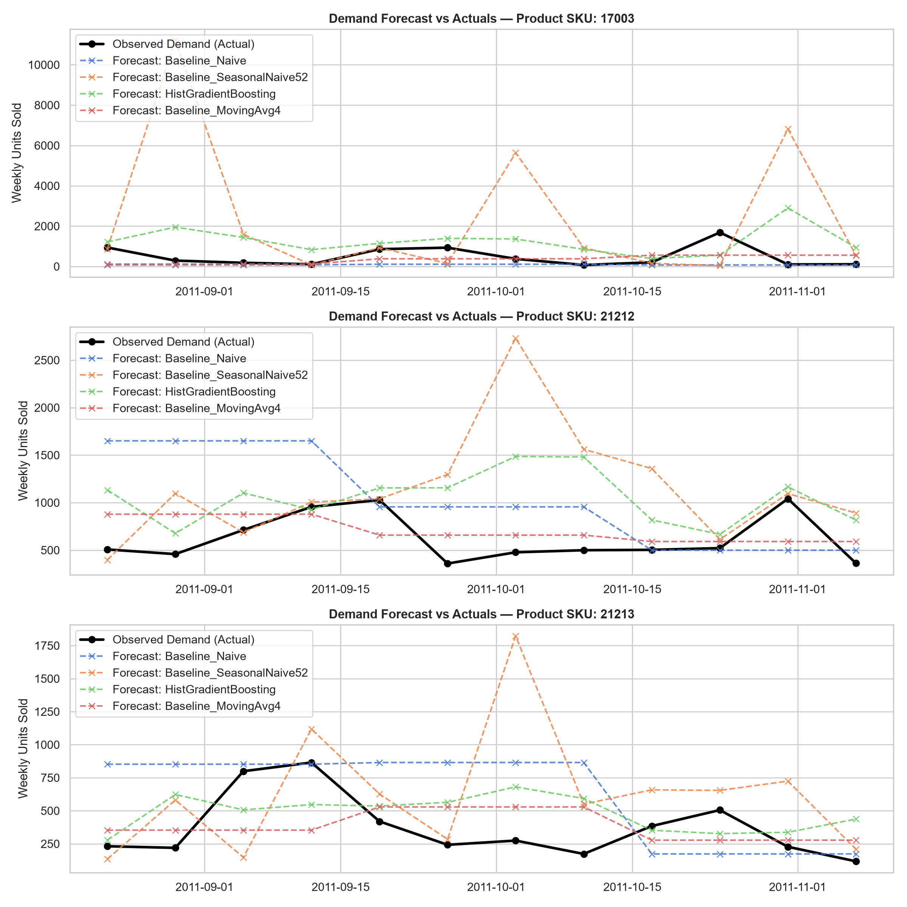

This trajectory comparison over multiple validation origins highlights how each algorithm handles real-world demand shifts:
- The **4-week Moving Average** smoothly tracks baseline sales trends without overreacting to isolated holiday spikes.
- The **HistGradientBoosting** candidate attempts to forecast sharp holiday spikes, leading to large over-prediction errors when timing is offset by even one week.

---

#### Error Growth Across Forecast Horizon Steps ($h = 1..4$)
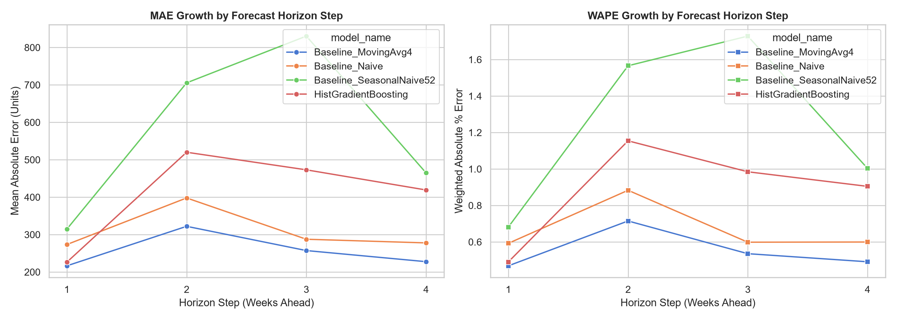

Multi-step recursive forecasting demonstrates predictable error growth across the 4-week planning window:
- Step 1 ($h=1$) exhibits the lowest error across all models.
- At Steps 3 and 4 ($h=3, 4$), the GBDT recursive feature feeding mechanism accumulates errors, accelerating MAE and WAPE inflation compared to the moving average benchmark.

---

#### Residual Error Distribution
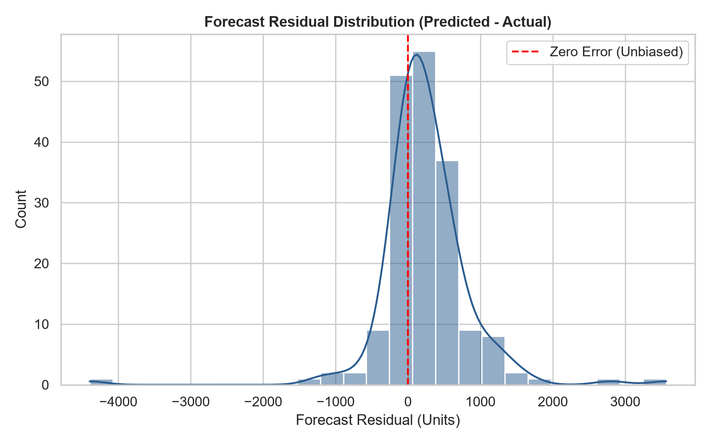

The residual diagnostic ($\hat{y} - y$) illustrates that supervised ML errors have a heavy right tail (over-forecasting), further confirming why baseline moving average was selected for production operations.

---

### 6.4 Scientific Analysis & Model Selection Integrity
1. **The Reality of Retail Intermittency & Volatility**: The 4-week Moving Average benchmark decisively outperforms the supervised ML model across all validation metrics (Validation WAPE: 55.16% vs. 88.30%; MASE: 0.5837 vs. 0.9680; MAE: 255.94 vs. 409.73; RMSE: 491.47 vs. 683.91).
2. **Promoting the Best Performer**: In strict adherence to ML engineering integrity, DemandCast promotes the winning **4-week Moving Average baseline** as the active production release (`v1.0.0`). The project avoids complex model bias: a complex model is not deployed when a simple baseline delivers superior accuracy.
3. **Tracking the ML Candidate**: `HistGradientBoosting` is retained and tracked in the model registry as `v1.0.0-candidate-hgb` for continuous research and hyperparameter optimization.
4. **Honest Evaluation Protocol**: Test set performance across the 3 complete held-out weeks (where Baseline_MovingAvg4 also led with 49.41% WAPE vs. 55.25% for HGB) is preserved purely for confirmatory evaluation and was never leaked to influence model selection decisions.
5. **Evaluation Horizon Provenance Reconciliation**:
   - **45-Observation Corrected Holdout (Authoritative, Run `845005ef`)**: Evaluates the 3 complete calendar weeks (`2011-11-14` through `2011-11-28`). HGB test MAE is **247.74** and WAPE is **55.25%**; Baseline_MovingAvg4 test MAE is **221.54** and WAPE is **49.41%**.
   - **60-Observation Pre-Audit Holdout (Historical, Run `85f46113`)**: Included the 4th calendar week (`2011-12-05`). Because the raw UCI data ended Friday Dec 9 at 12:50 PM, this 4th week had only 4.5 days observed (~50% actual volume), causing all models to appear over-predictive and elevating HGB test MAE to **264.80** and WAPE to **64.60%** (and Moving Average MAE to **226.37**, WAPE to **55.23%**).
   - **Hyperparameter Stability**: Neither model hyperparameters nor feature schemas were tuned in response to test feedback. Validation metrics are identical across both runs (HGB Val WAPE 88.30%, Baseline Val WAPE 55.16%).

---

## 7. Model Governance, Quality Alerts & Freshness Safeguards

### 7.1 Promotion Gates vs. Quality Alerts
DemandCast establishes a strict, audited boundary between candidate model selection and operational quality gates:
1. **Selection Rule**: Candidates are ranked by validation WAPE. The 4-week Moving Average baseline wins with 55.16% WAPE (vs. 88.30% for HistGradientBoosting).
2. **Quality Alert Gate**: The operational target threshold is configured at `wape_promotion_gate_threshold: 0.50` (50.00%). The promoted baseline's validation WAPE (55.16%) exceeds this target.
3. **Denied Overrides by Default**: The system policy (`allow_alert_promotion_override: false`) strictly denies promotion of any candidate exceeding the threshold unless an explicit `--allow-alert-override` flag AND a documented, non-empty `--reason <text>` string are supplied.
4. **Audited Operational Override**: `Baseline_MovingAvg4` was promoted under an explicit audited override because it decisively minimizes error compared to the ML model.
5. **Transparent Alert Status**: The alert is **never hidden or suppressed**. Active pointer `models/current.json`, `/ready`, `/metadata`, and monitoring reports all explicitly broadcast `quality_status: "ALERT"`.

### 7.2 Model Freshness & Stale-Model Warning
The active release `v1.0.0` was trained on historical transactions ending **November 7, 2011**:
- **Dataset Vintage**: UCI Online Retail II (2009–2011).
- **Modern Retail Disclaimer**: The model is **not calibrated for modern retail markets** without contemporary retraining. Predictions on historical inputs represent retrospective simulation / backtesting only.
- **Configurable Stale-Model Warning**: If an inference request provides an origin date exceeding the model training cutoff by more than `stale_model_threshold_days: 90`, the API automatically attaches a `StaleModelWarning` to the prediction payload:
  `"StaleModelWarning: Forecast origin is X days past model training cutoff (2011-11-07). Model was trained on historical data (2009-2011); predictions beyond the training horizon represent historical backtesting/replay and do not establish validity for modern retail markets."`
- **Historical Reproducibility**: Requests ending on the cutoff date (`2011-11-07`) run cleanly without stale warnings, ensuring historical verification remains fully reproducible.

### 7.3 Model Refresh & Retraining Protocol
To refresh the model for live operations:
1. Ingest contemporary retail transaction feeds (ERP/POS).
2. Aggregate to Monday week-start intervals ($[Monday\ 00:00:00, Sunday\ 23:59:59.999999]$).
3. Ensure $\ge 52$ consecutive weeks of continuous history for each SKU to support seasonal modeling.
4. Re-run expanding-window chronological validation backtesting.
5. Verify validation WAPE $\le 50.00\%$ before promoting without operational override.

### 7.4 Versioned Registry Commands
Releases are managed via `src/demandcast/registry.py` under `models/releases/<version>/`:
- `model.joblib`: Serialized forecaster bundle and metadata.
- `metadata.json`: SHA-256 artifact checksum, validation metrics, test metrics, quality status, model freshness, and MLflow run ID.
- `models/current.json`: Atomic pointer pointing to the active release.

```powershell
# Promote a release (requires --allow-alert-override and --reason if WAPE > threshold)
python scripts/promote_model.py --version v1.0.0 --allow-alert-override --reason "Promoted winning 4-week moving average baseline on validation backtests (WAPE: 55.16%, MASE: 0.5837 vs HGB 88.30%) under audited quality alert override"

# Roll back to a previous release atomically
python scripts/rollback_model.py --to v1.0.0 --reason "Operational rollback requested"
```

---

## 8. REST API & Serving Layer

The production API is built with **FastAPI** (`src/demandcast/api/`):

### Endpoints
- `GET /health`: Liveness probe indicating server process health (`{"status": "healthy"}`).
- `GET /ready`: Readiness probe verifying that model release, metadata, quality status, and freshness are loaded. Returns `quality_status: "ALERT"`, `quality_alert`, and `model_freshness_status: "stale_historical_dataset"`. Returns HTTP 503 if not ready.
- `GET /metadata`: Governance endpoint returning model version, quality status, detailed model freshness (dataset vintage, training cutoff, refresh requirements), validation metrics, and limitations.
- `POST /forecast`: Generates recursive 4-week point forecasts. Rejects origins predating training cutoff (`2011-11-07`) with HTTP 400 `TemporalContractViolation`; attaches `StaleModelWarning` if origin exceeds cutoff by $> 90$ days.

### Example Request (`POST /forecast`)
Using historical weekly sales observations through the model's training cutoff date (`2011-11-07`):
```json
{
  "series_id": "17003",
  "horizon": 4,
  "history": [
    { "week_start": "2011-08-08", "demand": 140.0 },
    { "week_start": "2011-08-15", "demand": 78.0 },
    { "week_start": "2011-08-22", "demand": 940.0 },
    { "week_start": "2011-08-29", "demand": 291.0 },
    { "week_start": "2011-09-05", "demand": 180.0 },
    { "week_start": "2011-09-12", "demand": 109.0 },
    { "week_start": "2011-09-19", "demand": 189.0 },
    { "week_start": "2011-09-26", "demand": 412.0 },
    { "week_start": "2011-10-03", "demand": 218.0 },
    { "week_start": "2011-10-10", "demand": 420.0 },
    { "week_start": "2011-10-17", "demand": 380.0 },
    { "week_start": "2011-10-24", "demand": 490.0 },
    { "week_start": "2011-10-31", "demand": 620.0 },
    { "week_start": "2011-11-07", "demand": 607.0 }
  ]
}
```

### Example Response (`POST /forecast` — UCI Profile)
```json
{
  "forecast_run_id": "8f3b251a-4bc1-49b8-a612-92e105db089e",
  "created_at": "2026-10-25T10:00:00.000000+00:00",
  "series_id": "17003",
  "model_version": "v1.0.0",
  "model_name": "Baseline_MovingAvg4",
  "last_historical_date": "2011-11-07",
  "forecast_start_date": "2011-11-14",
  "forecast_end_date": "2011-12-05",
  "horizon": 4,
  "forecasts": [
    { "week_start": "2011-11-14", "horizon_step": 1, "predicted_demand": 524.25 },
    { "week_start": "2011-11-21", "horizon_step": 2, "predicted_demand": 524.25 },
    { "week_start": "2011-11-28", "horizon_step": 3, "predicted_demand": 524.25 },
    { "week_start": "2011-12-05", "horizon_step": 4, "predicted_demand": 524.25 }
  ],
  "warnings": []
}
```

### DemandCast v2 Endpoint (`POST /v2/forecast` — VN1 Profile)

Accepts product–warehouse series identifiers (`client_id_warehouse_id_product_id`), optional prices, and 12+ weeks of Monday sales history to generate 13-week recursive forecasts:

```json
{
  "series_id": "0_1_PROD1",
  "horizon": 13,
  "history": [
    { "week_start": "2023-07-03", "sales": 15.0, "price": 12.99 },
    { "week_start": "2023-07-10", "sales": 18.0, "price": 12.99 },
    { "week_start": "2023-07-17", "sales": 0.0, "price": 12.99 },
    { "week_start": "2023-07-24", "sales": 22.0, "price": 12.99 },
    { "week_start": "2023-07-31", "sales": 14.0, "price": 12.99 },
    { "week_start": "2023-08-07", "sales": 0.0, "price": 12.99 },
    { "week_start": "2023-08-14", "sales": 25.0, "price": 12.99 },
    { "week_start": "2023-08-21", "sales": 30.0, "price": 12.99 },
    { "week_start": "2023-08-28", "sales": 19.0, "price": 12.99 },
    { "week_start": "2023-09-04", "sales": 0.0, "price": 12.99 },
    { "week_start": "2023-09-11", "sales": 27.0, "price": 12.99 },
    { "week_start": "2023-09-18", "sales": 33.0, "price": 12.99 },
    { "week_start": "2023-09-25", "sales": 21.0, "price": 12.99 },
    { "week_start": "2023-10-02", "sales": 28.0, "price": 12.99 }
  ]
}
```

```json
{
  "forecast_run_id": "d82046ca-4663-4da2-9bfe-b39f75ec5ce3",
  "dataset_profile": "vn1",
  "created_at": "2026-10-25T18:48:18.998000+00:00",
  "series_id": "0_1_PROD1",
  "model_version": "v1.0.0",
  "model_name": "Baseline_MovingAvg12_Official",
  "last_historical_date": "2023-10-02",
  "forecast_start_date": "2023-10-09",
  "forecast_end_date": "2024-01-01",
  "horizon": 13,
  "forecasts": [
    { "week_start": "2023-10-09", "horizon_step": 1, "predicted_sales": 19.75 },
    { "week_start": "2023-10-16", "horizon_step": 2, "predicted_sales": 19.75 },
    { "week_start": "2023-10-23", "horizon_step": 3, "predicted_sales": 19.75 },
    { "week_start": "2024-01-01", "horizon_step": 13, "predicted_sales": 19.75 }
  ],
  "warnings": []
}
```

---

## 9. Operational Monitoring & Drift Detection

DemandCast provides an offline evaluation workflow in `src/demandcast/monitoring.py` and `scripts/evaluate_forecasts.py`:
- **WAPE & Bias Alerts**: Alerts triggered if aggregate WAPE $> 50\%$ or normalized relative bias exceeds $\pm 25\%$ ($\text{Relative Bias} = \frac{\sum (\hat{y} - y)}{\sum y}$).
- **Two-Sample Kolmogorov-Smirnov Test**: Serves as a descriptive marginal distribution diagnostic comparing forecast outputs against observed actual demand.
- **Residual Tracking**: Measures error distribution across percentiles, standard deviations, individual forecast horizons ($h \in \{1, 2, 3, 4\}$), and product series.
- **Input Data Drift**: Evaluates incoming series mean shifts against training baseline statistics ($\mu_{\text{train}}, \sigma_{\text{train}}$) to flag upstream data shifts before prediction.
- **Truthful Status**: Monitoring quality cannot be evaluated without ground-truth actuals; synthetic actuals are never fabricated.
- **Output Audit**: Stored in `reports/monitoring_report.json`.

---

## 10. Reproducibility & Commands Guide

### 10.1 Environment Setup (Windows PowerShell)
```powershell
# Create and activate virtual environment
python -m venv .venv
.\.venv\Scripts\Activate.ps1

# Install package and pinned dependencies
pip install -r requirements.txt
pip install -e .
```

### 10.2 Run Full Data & Training Pipelines

#### UCI Profile (DemandCast v1)
```powershell
# 1. Download official UCI dataset and verify SHA-256 checksum
python scripts/download_data.py

# 2. Clean transactions, select products, and aggregate weekly demand
python scripts/prepare_data.py

# 3. Execute expanding-window backtesting across baselines and ML
python scripts/run_backtests.py

# 4. Train candidate model and package release v1.0.0
python scripts/train_model.py --version v1.0.0

# 5. Promote release to active model pointer
python scripts/promote_model.py --version v1.0.0 --allow-alert-override --reason "Audited promotion"

# 6. Run post-forecast monitoring and drift evaluation
python scripts/evaluate_forecasts.py

# 7. Verify live API endpoints and temporal contracts
python scripts/verify_api_live.py
```

#### VN1 Profile (DemandCast v2 Upgrade)
```powershell
# 1. Download and verify official VN1 challenge dataset files (Phases 0, 1, 2)
python scripts/download_vn1_data.py

# 2. Run chronological Phase 1 validation across 6 models, log to MLflow, and package/promote v1.0.0
python scripts/train_vn1_pipeline.py --version v1.0.0 --series-sample 250

# 3. Execute final Phase 2 ground-truth holdout evaluation against published actuals
python scripts/evaluate_vn1_phase2.py
```

### 10.3 Run Automated Tests & Code Quality
```powershell
# Run Ruff linting and formatting verification
ruff check .
ruff format --check .

# Run complete test suite (78 unit and integration tests under strict zero-warning policy)
pytest -v
```

### 10.4 Inspect Experiments in MLflow
```powershell
mlflow ui --backend-store-uri sqlite:///mlflow.db --port 5000
```
Visit `http://localhost:5000` to inspect experiment parameters, validation backtests, model artifacts, and evaluation figures across both `demandcast_forecast_system` (UCI profile) and `demandcast-vn1` (VN1 profile).

### 10.5 Local Container Deployment (Docker Compose)
```powershell
# Build and run API with mounted model releases
docker compose up --build
```
Interactive API documentation: `http://localhost:8000/docs`

---

## 11. Project Directory Structure

```
demandcast/
├── README.md                           # Master project documentation with architecture & figures
├── pyproject.toml                      # Package build configuration & tool settings
├── requirements.txt                    # Pinned runtime and development dependencies
├── Dockerfile                          # Multi-stage production container definition
├── compose.yaml                        # Local container orchestration
├── .gitignore                          # Git exclusions (raw data, virtualenvs, mlruns)
├── .dockerignore                       # Docker build exclusions
├── configs/
│   ├── config.yaml                     # UCI profile system configuration
│   └── vn1_config.yaml                 # VN1 challenge profile configuration
├── data/
│   ├── raw/                            # Raw UCI archive & extracted excel files
│   ├── interim/                        # Cleaned transactions (parquet)
│   ├── processed/                      # Weekly demand parquet & selected_series.json
│   └── vn1/                            # VN1 raw datasets, provenance & processed cubes
├── src/demandcast/
│   ├── __init__.py                     # Package init
│   ├── config.py                       # Pydantic configuration schemas & path resolution
│   ├── data_loading.py                 # UCI download, SHA-256 verification, Excel loader
│   ├── data_validation.py              # Auditable transaction cleaning & quality reporting
│   ├── aggregation.py                  # Monday weekly aggregation & training-only SKU selection
│   ├── features.py                     # Leakage-safe lags, shifted rolling stats, calendar
│   ├── baselines.py                    # Naive persistence, 4w moving average, 52w seasonal
│   ├── models.py                       # HistGradientBoostingRegressor recursive forecaster
│   ├── backtesting.py                  # Chronological expanding-window backtesting engine
│   ├── metrics.py                      # MAE, RMSE, WAPE, sMAPE, MASE, Forecast Bias
│   ├── train.py                        # Model training pipeline & MLflow logging
│   ├── evaluate.py                     # Benchmark comparison & visualization plotting
│   ├── tracking.py                     # MLflow experiment tracking helper
│   ├── registry.py                     # Versioned model packaging, promotion & rollback
│   ├── forecasting.py                  # Pre-inference validation & response formatting
│   ├── monitoring.py                   # Input quality checks, actuals reconciliation, drift
│   ├── vn1/                            # Isolated VN1 Challenge Subpackage
│   │   ├── __init__.py                 # VN1 exports
│   │   ├── config.py                   # VN1 Pydantic configuration schema
│   │   ├── metrics.py                  # Official VN1 score & composite metrics
│   │   ├── data_loading.py             # Wide-to-long merged cube constructor
│   │   ├── baselines.py                # Official 12w MA, 4w MA, Naive, 52w Seasonal
│   │   ├── features.py                 # Recursive multi-step features with price awareness
│   │   ├── models.py                   # LightGBM recursive multi-step forecaster
│   │   ├── backtesting.py              # Chronological Phase 1 validation engine
│   │   └── registry.py                 # Isolated VN1 versioned model registry
│   └── api/
│       ├── __init__.py
│       ├── main.py                     # FastAPI application factory & lifespan context
│       ├── routes.py                   # Routes (/health, /ready, /metadata, /forecast, /v2/forecast)
│       ├── schemas.py                  # Pydantic request & response models (dual profiles)
│       └── dependencies.py             # Active model dependency injection containers
├── scripts/
│   ├── download_data.py                # Download UCI archive
│   ├── prepare_data.py                 # Clean, select SKUs, aggregate weekly demand
│   ├── run_backtests.py                # Run expanding-window backtests
│   ├── train_model.py                  # Train and package model release
│   ├── evaluate_model.py               # Generate model comparison report
│   ├── promote_model.py                # Validate and promote release
│   ├── rollback_model.py               # Safe rollback to prior release
│   ├── evaluate_forecasts.py           # Offline reconciliation & drift evaluation
│   ├── verify_api_live.py              # End-to-end live API validation test
│   ├── download_vn1_data.py            # Download & verify VN1 dataset files (Phases 0, 1, 2)
│   ├── train_vn1_pipeline.py           # Full VN1 backtesting, MLflow logging & promotion
│   └── evaluate_vn1_phase2.py          # Final Phase 2 ground-truth holdout evaluation
├── reports/
│   ├── model_comparison.csv            # UCI benchmark comparison table
│   ├── backtest_results.csv            # UCI validation forecasts vs actuals
│   ├── test_horizon_results.csv        # UCI held-out test predictions
│   ├── data_quality_report.json        # UCI cleaning and exclusion counts
│   ├── figures/                        # UCI high-resolution evaluation graphs
│   └── vn1/                            # VN1 Reports & Artifacts
│       ├── model_comparison.csv        # 6-candidate VN1 Phase 1 benchmark comparison
│       ├── validation_results.csv      # Phase 1 validation forecast table (3,250 rows)
│       ├── metrics_by_horizon.csv      # Error growth across weeks 1 to 13
│       ├── metrics_by_series.csv       # Granular errors per product-warehouse series
│       ├── phase2_test_results.csv     # 13-week holdout predictions evaluated against actuals
│       ├── phase2_model_comparison.csv # Final Phase 2 comparison (Full benchmark & Subset)
│       ├── phase2_evaluation_summary.json # Comprehensive Phase 2 governance audit record
│       ├── data_quality_report.json    # VN1 intermittency & zero-sales statistics
│       └── figures/                    # VN1 high-resolution evaluation graphs
│           ├── model_comparison_bar.png# Phase 1 comparison (VN1 Score, WAPE, Bias)
│           ├── metrics_by_horizon.png  # Error propagation over 13 weeks
│           ├── forecast_comparison.png # Phase 1 prediction trajectories vs actuals
│           ├── phase2_model_comparison.png # Phase 2 holdout scores across models
│           └── phase2_forecast_examples.png# Phase 2 predictions vs ground truth actuals
├── models/
│   ├── releases/                       # UCI model releases (v1.0.0)
│   ├── current.json                    # UCI active promoted release pointer
│   └── profiles/
│       └── vn1/
│           ├── releases/               # VN1 model releases (v1.0.0)
│           └── current.json            # VN1 active promoted release pointer
├── tests/
│   ├── conftest.py                     # Fast, deterministic test fixtures
│   ├── test_data_validation.py         # Tests for cleaning rules & exclusions
│   ├── test_aggregation.py             # Tests for Monday aggregation & SKU selection
│   ├── test_features.py                # Tests for shifted rolling stats & lags
│   ├── test_backtesting.py             # Tests for expanding-window temporal integrity
│   ├── test_metrics.py                 # Tests for MAE, RMSE, WAPE, sMAPE, MASE
│   ├── test_training.py                # Tests for ML model fitting & recursive forecasting
│   ├── test_registry.py                # Tests for release packaging, checksum & tampering
│   ├── test_api.py                     # Tests for FastAPI endpoints & input validation
│   ├── test_monitoring.py              # Tests for drift detection & quality checks
│   ├── test_rollback.py                # Tests for model promotion & rollback lifecycle
│   ├── test_vn1_metrics.py             # Tests for official VN1 score formula & bias
│   ├── test_vn1_baselines.py           # Tests for VN1 Naive, 12w MA, 4w MA
│   ├── test_vn1_features.py            # Tests for VN1 feature engineering & leakage prevention
│   ├── test_vn1_registry.py            # Tests for VN1 model registry, packaging & quality gate
│   ├── test_vn1_api.py                 # Tests for /v2/forecast, dual /ready & /metadata
│   └── test_vn1_phase2.py              # Tests for Phase 2 ground-truth evaluation & official scoring
├── docs/
│   ├── architecture.md                 # System architecture & sequence diagrams
│   ├── methodology.md                  # Forecasting problem formulation & backtest design
│   ├── monitoring.md                   # Operational monitoring & rollback protocol
│   └── model_card.md                   # Comprehensive model governance card
└── .github/
    └── workflows/
        └── ci.yml                      # GitHub Actions CI workflow (lint, test, build)
```

---

## 12. Known Limitations & Production Caveats

1. **Observed Sales Proxy**: The target is observed positive sales volume. In retail, unobserved stockouts suppress sales, meaning that historical zero-sales weeks do not prove zero customer demand.
2. **Dataset Age**: The dataset represents UK e-commerce giftware transactions from 2009–2011. While valuable for methodology demonstration, deploying this model in a modern retail setting requires fresh transactional and promotional data.
3. **Temporal Contract**: The standard `/forecast` endpoint rejects forecast origins predating the model training cutoff (`2011-11-07`) to prevent in-sample lookahead bias.
4. **History Depth Requirements**: Minimum history is 4 weeks for the active Moving Average forecaster, 13 weeks for the supervised ML candidate (or 53 weeks if seasonal lag 52 is enabled).
5. **Container Deployment Status**: The multi-stage `Dockerfile` and `compose.yaml` configurations are fully implemented with read-only release volume mounts; local container runtime execution could not be verified because the host Docker Desktop engine is currently stopped.
6. **Continuous Integration Status**: GitHub Actions CI workflow is configured in `.github/workflows/ci.yml` (linting, pytest suite, and docker build); hosted execution runs automatically upon push to GitHub.
7. **Git Repository Status**: The repository is tracked on branch `main` at **[https://github.com/Looka-info/Production-ML-forecasting-system](https://github.com/Looka-info/Production-ML-forecasting-system)**.
