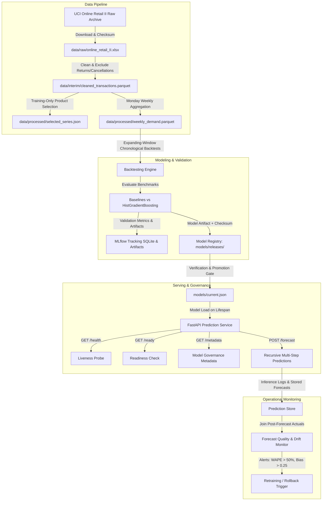
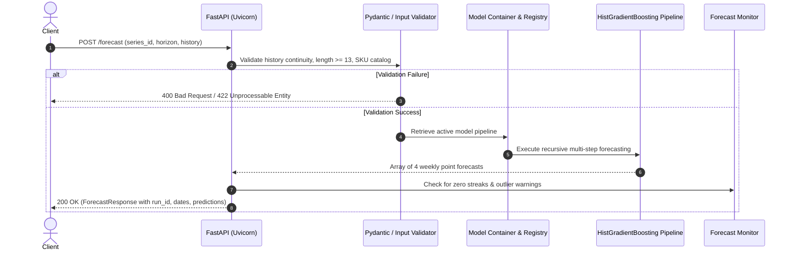

# DemandCast System Architecture

## 1. System Overview

**DemandCast** is a production-grade machine learning system designed to forecast weekly retail demand for product SKUs. Built according to modern MLOps principles, it encompasses the complete lifecycle from data ingestion to containerized model serving, automated governance, and drift monitoring.

---

## 2. Component Design & Boundaries

### 2.1 Ingestion & Cleaning Layer (`src/demandcast/data_loading.py`, `data_validation.py`)
- **Dataset**: UCI Online Retail II (Chen, 2012; CC BY 4.0).
- **Integrity**: Computes SHA-256 checksum upon acquisition.
- **Auditable Exclusions**:
  - Cancelled transactions (invoices starting with `C`) are removed from primary demand target.
  - Returns and non-positive quantities ($q \le 0$) and prices ($p \le 0$) are excluded.
  - Non-merchandise items (e.g., postage, bank charges, manual adjustments) are identified and purged.
  - Customer identifiers are stripped immediately to prevent identity leakage and protect privacy.
  - Generates auditable data quality report (`reports/data_quality_report.json`).

### 2.2 Time-Series Aggregation (`src/demandcast/aggregation.py`)
- **Calendar Convention**: Fixed weekly grid starting on **Monday** (`W-MON`).
- **Target Definition**: Total units sold per SKU in each calendar week.
- **Continuous Timeline**: For all active products, missing intermediate weeks are filled with zero demand.
- **Stockout Distinction**: Zero observed sales is treated as observed demand proxy, with explicit documentation that it does not prove unconstrained customer demand due to potential inventory stockouts.
- **Leakage-Safe Selection**: Top products are selected strictly using transactions **prior to the training cutoff date** (`2010-10-01`). Full-dataset volumes are never used for SKU selection.

### 2.3 Feature Engineering Layer (`src/demandcast/features.py`)
- **Strictly Shifted Rolling Statistics**: All rolling windows (`mean`, `std`, `zero_freq`) apply `.shift(1)` before calculating rolling summaries. The target week $t$ never influences features at week $t$.
- **Lags**: $t-1, t-2, t-3, t-4, t-8, t-12$ (and seasonal $t-52$ when history length permits).
- **Calendar Features**: Known ahead of time: `week_of_year`, `month`, and cyclical sinusoidal transforms `sin_week`, `cos_week`.
- **Categorical Identifier**: Product SKU identifier encoded via scikit-learn's `OrdinalEncoder` fitted on training data with unknown value handling.

### 2.4 Modeling & Recursive Multi-Step Engine (`src/demandcast/models.py`)
- **Estimator**: `HistGradientBoostingRegressor` (scikit-learn), optimized for histogram-based gradient boosting on tabular time-series features.
- **Recursive Forecasting**: At horizon step $h \in \{1, 2, 3, 4\}$, features are calculated using historical observations plus model-generated predictions from steps $1 \dots h-1$.
- **Nonnegativity Constraint**: Predicted demand is postprocessed through $\hat{y} = \max(0, \hat{y})$.

### 2.5 Chronological Backtesting & Metrics (`src/demandcast/backtesting.py`, `metrics.py`)
- **Expanding-Window Cross-Validation**: Shared temporal cutoffs across all series.
- **Untouched Final Test Set**: The latest 4 calendar weeks are reserved as a strictly held-out test horizon, never seen during model selection.
- **Metric Suite**: MAE, RMSE, WAPE (Weighted Absolute Percentage Error), sMAPE, MASE (scaled against training naive MAE), and forecast bias.

### 2.6 Model Registry & Lifecycle Governance (`src/demandcast/registry.py`)
- **Releases Directory (`models/releases/<version>/`)**: Contains immutable release bundles:
  - `model.joblib`: Serialized scikit-learn pipeline and feature schema.
  - `metadata.json`: SHA-256 checksum, training date range, validation metrics, test metrics, supported series catalog, and git/mlflow commit references.
- **Pointer File (`models/current.json`)**: Points atomically to the active serving release.
- **Automated Validation Gates**: Promotion scripts verify artifact checksums and run end-to-end inference smoke tests before switching the pointer.
- **Atomic Rollback**: If degradation is detected, `scripts/rollback_model.py` safely restores a prior valid version.

### 2.7 Production Serving API (`src/demandcast/api/`)
- Built with **FastAPI** and **Pydantic v2**.
- Non-root user in Docker container (`python:3.12-slim`).
- Health (`/health`), readiness (`/ready`), metadata (`/metadata`), and inference (`/forecast`) endpoints.
- Input validation: verifies strictly consecutive 7-day weekly intervals, minimum required history length (13 weeks), and supported series membership.

---

## 3. Data Flow Diagram

